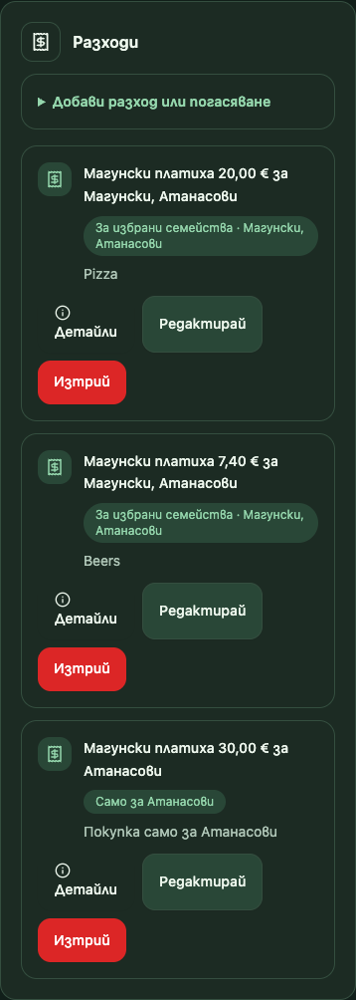
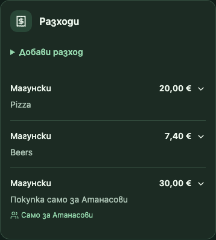

# Локална поправка на UI регресиите

Снимките са от **реалните React компоненти**, рендерирани в изолиран локален fixture с тестови семейства и разходи, в headless Google Chrome чрез разрешения Playwright. Не е използвана продукционна Firebase база. Навигационната рамка на fixture-а е опростена; това не е тест на входа или продукционната инфраструктура. „Преди“ е кодът от staging commit `3e86dcd`, „след“ са локалните промени върху него.

## Преди / след на телефон, 390 CSS px

| Изглед | Преди | След |
|---|---|---|
| Основен мобилен изглед | [Снимка](before/mobile.png) | [Снимка](after/390-dark.png) |
| Отворена форма в секцията | [Снимка](before/form-context.png) | [Снимка](after/form-context.png) |
| История на разходите | [Снимка](before/history-context.png) | [Снимка](after/history-context.png) |

### История

| Преди | След |
|---|---|
|  |  |

[Сравнение на историята в една снимка](history-comparison.png) · [Сравнение на формата в една снимка](form-comparison.png)

За отворената форма след поправката има и [близък изглед](after/form.png).

## Измерени резултати

- Проверени ширини: **320, 375, 390, 430, 768 и 1280 CSS px**, всяка в светла и тъмна тема.
- Стандартният сгънат ред е **77.5 CSS px**. Преди първите два записа при 390 px бяха **276.25 CSS px** всеки. Дългите имена и увеличеният текст могат естествено да увеличат височината.
- Вертикално разстояние от действията до бялата карта на телефон: **24 CSS px**.
- Основният бутон има височина **44 CSS px**, иконата запазва ширина **18 CSS px**.
- Няма хоризонтално преливане при нито една проверена ширина/тема, включително с дълги имена, голяма сума и 200% текстов stress test (увеличен основен/root шрифт, не браузърен zoom).
- `prefers-reduced-motion: reduce` спира анимацията на редовете. Цветовете на бялата карта са фиксирани и четими и в тъмна тема.
- Проверени с клавиатура: отваряне на формата, достигане на платеца с Tab, разгъване на запис с Enter, редакция и връщане на фокуса при отказ.
- Проверени: правилният бутон отваря съществуващия AddFamilyModal; за участник бутонът не се показва; редакцията е достъпна след разгъване; отказът от потвърждението за изтриване запазва записа.
- Горната карта използва резултати от съществуващите `calculateFamilyBalances` и `calculateDebts`, споделени с подробното резюме. Проверени са дългове, първите три при повече разплащания, директна връзка/фокус към подробностите, уредени сметки, липса на разходи, зареждане и грешка. При последните две не се показва нулева сума.
- Общият Button е проверен допълнително във формата за вход и wizard-а за ново пътуване при 320/768/1280 px.

[Измервания за всички размери и теми](metrics.json) · [Измервания преди поправката](before-metrics.json)

## Други размери

| CSS px | Светла тема | Тъмна тема |
|---|---|---|
| 320 | [Снимка](after/320-light.png) | [Снимка](after/320-dark.png) |
| 375 | [Снимка](after/375-light.png) | [Снимка](after/375-dark.png) |
| 390 | [Снимка](after/390-light.png) | [Снимка](after/390-dark.png) |
| 430 | [Снимка](after/430-light.png) | [Снимка](after/430-dark.png) |
| 768 | [Снимка](after/768-light.png) | [Снимка](after/768-dark.png) |
| 1280 | [Снимка](after/1280-light.png) | [Снимка](after/1280-dark.png) |

[320 px с увеличен текст и дълги имена](after/320-large-text.png)

## Променени файлове

- `TripHeader.tsx` — връща owner-only „Добави семейство“; отделна покана; показва предоставените разплащания и всички състояния на зареждане.
- `pages/trips/[tripId]/index.tsx` — споделя резултатите на съществуващите балансови функции между горната карта и DebtsSummary; локализира добавянето на разход; задава anchor към подробностите.
- `DebtsSummary.tsx` — приема споделените резултати и показва зареждане/грешка без подвеждащи нули.
- `Button.tsx` — единен Tailwind източник, inline-flex, gap, несвиващи се икони, минимален touch target 44×44. Неизползваният `Button.module.css` е премахнат.
- `SectionCard.tsx` — една повърхност, без конкуриращия padding на Card; 16 px на телефон.
- `AddExpenseForm.tsx` — изрични embedded/standalone варианти и контрол на заглавието; режимите и логиката на записа са запазени.
- `ExpensesTable.tsx` — компактни редове, съкратен коментар, малки индикатори; пълно описание, дата, дялове и действия при разгъване; запазени странициране, редакция и потвърждение за изтриване.
- `globals.css` — мобилен gap, фиксиран контраст на бялата карта и компактна подредба на редовете.
- `tests/expenseForm.test.tsx` — обновен тест за редакция след разгъване и два теста за промененото UI поведение.

Финансовите функции, историческите записи, API авторизацията, Firebase правилата и функционалността на поканите **не са променяни**. Няма миграция, публикуване или push.

## Автоматични проверки

`npm run lint`, `npm run typecheck`, `npm test` (**18/18**) и `npm run build -- --webpack` минават. Съществуващите финансови тестове покриват общ разход, покупка за друго семейство, дялове и последващо погасяване. Нови финансови формули/тестове не са добавяни. Локалните Playwright проверки минават за 12 комбинации размер/тема и отделните stress/keyboard/state сценарии, без page errors.

Остава проверка на физически телефон с реален Safari/Chrome и собствените данни на потребителя; screenshot fixture-ите не заместват този тест.
